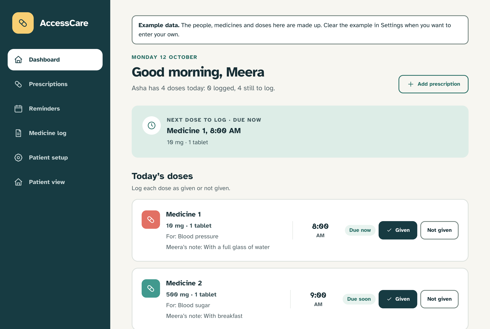
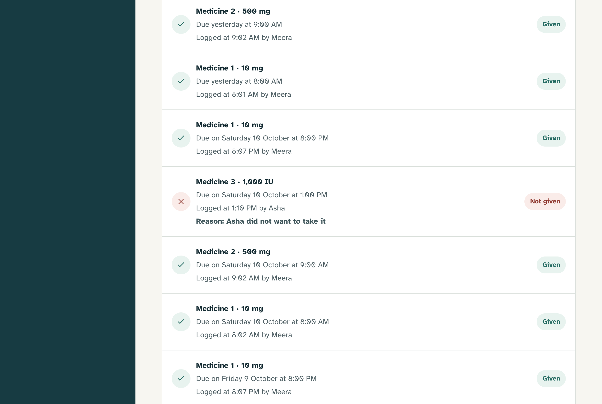
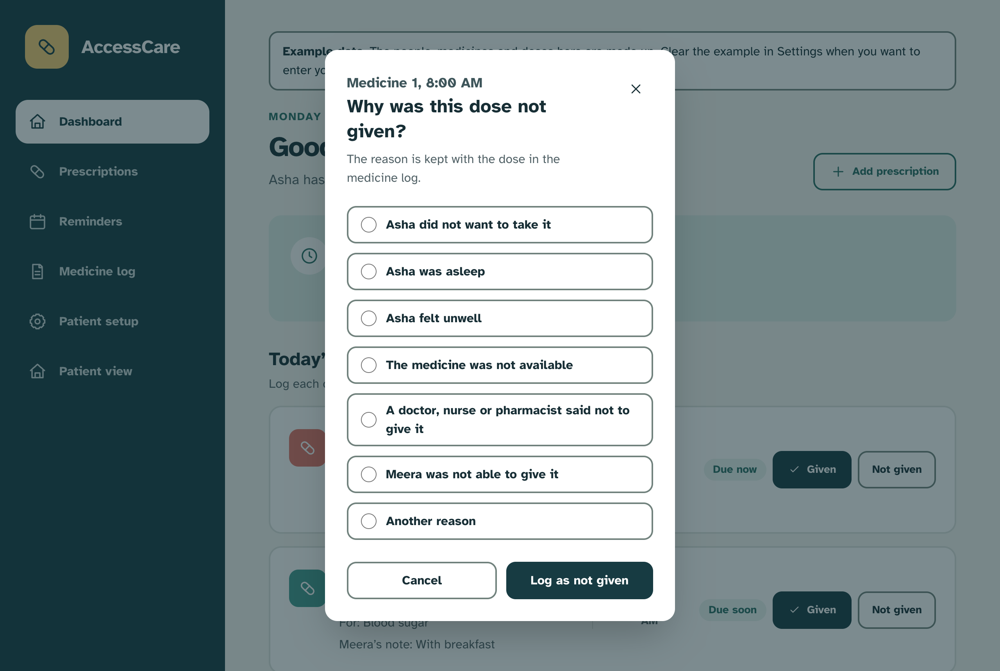
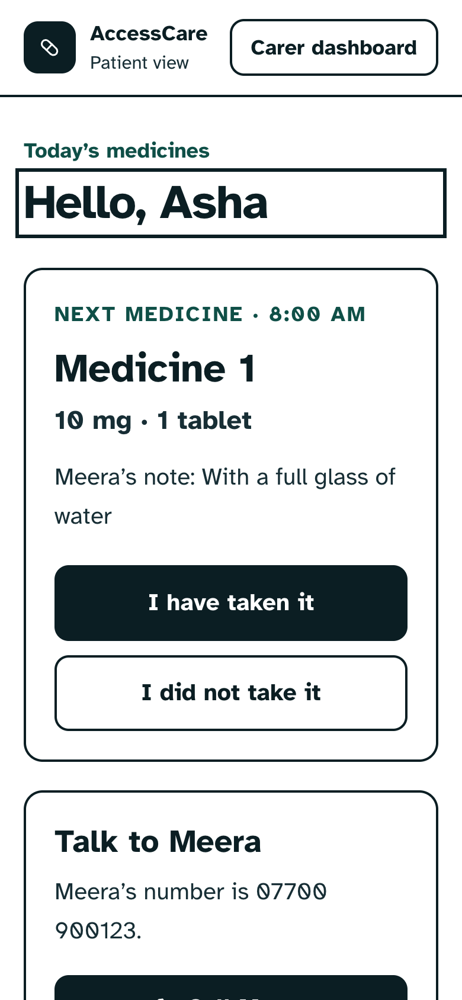

# AccessCare

A medication notebook for a carer and the person they support. It lists each day's doses, lets either of them log what happened to each one, and keeps that log on the device.

**[Open the live app](https://slayniaccc.github.io/medication-management-dashboard/)** and choose "Load the example" to see a week of made-up data. Nothing you enter leaves your browser.

It is a notebook, not a clinician. It records what you enter and shows it back. It never gives medical advice.



## At a glance

|                |                                                                                                       |
| -------------- | ----------------------------------------------------------------------------------------------------- |
| **What it is** | A local-first web app for logging medication doses, built for two users with very different needs     |
| **Built with** | React 19, TypeScript, Vite, Tailwind CSS v4, IndexedDB, Vitest, axe-core                              |
| **Runs on**    | Any modern browser. No account, no server, two runtime dependencies (`react` and `react-dom`)         |
| **Tested by**  | Over 240 tests in the gate: the dose model, colour contrast in every theme, and axe-core on each view |
| **Origin**     | A team hackathon prototype for CodeForAll 2026, rebuilt solo into something that works                |
| **Status**     | Working and deployed. Manual screen reader and keyboard passes are still to do, and it says so below  |

## What this project shows

If you are reading this as a piece of work rather than as a user, these are the parts worth looking at.

- **A data model designed from the problem, not from the UI.** The prototype stored a `status` on each medication, so it had no concept of tomorrow. The rebuild separates definition, intent and event, derives everything that can be derived, and never stores "pending". See [How the data works](#how-the-data-works) and `src/model/`.
- **Accessibility as a tested property.** Contrast ratios are a unit test over the design tokens in three themes. Every view, dialog and failed form is rendered and run through axe-core on every push. The 44 pixel target floor, the focus handling and the reduced motion rules are all written down as invariants and checked.
- **A product boundary held on purpose.** The app does not advise, warn or interpret, and the README explains where that line sits and why. Features the prototype only pretended to have were deleted rather than left in for show.
- **Decisions written down as they were made.** [`docs/DECISIONS.md`](docs/DECISIONS.md) holds more than fifty entries, each with the alternative that was rejected and the reason.
- **An honest inventory.** [`AGENTS.md`](AGENTS.md) lists what is unfinished and what has not been verified, in the same detail as what is done.

## The problem

Asha is 63 and lives with conditions affecting her vision, mobility and cognition. Meera, her daughter, manages Asha's medication routine with no tools, no guidance and no shared system. The logistical load and the worry both land on Meera.

The moment this project targets is the one that repeats several times a day: a dose is due, something happens to it, and somebody needs to know afterwards what that was. Was it given? If not, why not? Who wrote that down, and when?

Both of them use the app, and they need different things from it:

- **Meera** needs to read the state of today at a glance when she is tired and in a hurry, and to log a dose in one press.
- **Asha** needs a view she can actually use: high contrast, large text, large targets, no gestures, and nothing that talks over her screen reader.

A change that helps one at the other's expense is a regression.

The scope is deliberately narrow. One moment in a carer's day handled completely is worth more than five handled partially, so this is not a general health platform and is not trying to become one.

## What is built

- **Today's doses**, in time order, each logged as given or not given in one press. Due soon and overdue are worked out from the clock and shown to the carer only.
- **A reason for every dose not given**, chosen from seven and stored with the dose: did not want it, asleep, unwell, not available, withheld on clinical advice, carer not able, other. These are different facts and are kept apart. Asha declining a dose is her choice, a dose withheld on advice is a correct action, and a carer who could not manage it is a signal about the carer.
- **A medicine log** showing when each dose was due, when it was logged and by whom. The gap between those two times is kept, because 8:05 for an 8:00 dose and 11pm for the same dose are different days.
- **Prescriptions** added from what the carer types. Removing one asks first, keeps everything already logged, and can be undone from a list of removed prescriptions.
- **A patient view** for Asha with its own theme (light, high contrast, dark), text size, simplified layout, colours that do not rely on red and green, and an optional read aloud button. It can be read-only, or she can log her own doses in her own words.
- **First run and an example.** A new device starts empty and asks for two names. There is also a made-up week to look around in, which is labelled as an example on every carer page and can be cleared.

### What it looks like

The medicine log keeps the time each dose was due beside the time it was logged, and who logged it.



A dose that was not given always has a reason, chosen from seven.



The patient view on a phone, in the high contrast theme. The carer's note is shown as hers, not as an instruction from the app.



The screenshots show the made-up example week.

### Trying it

1. Open the [live app](https://slayniaccc.github.io/medication-management-dashboard/) and choose **Load the example**.
2. On the dashboard, log one of today's doses as given, and another as not given with a reason.
3. Open **Medicine log** to see both, with the time each was due, the time it was logged and who logged it. The example week includes a dose logged four hours late and a reminder time that changed mid-week.
4. Open the **patient view** and change the theme and text size in patient setup to see Asha's side of it.
5. Refresh the page. Everything is still there.

## What is deliberately not built

**No medical advice.** The app does not suggest, calculate or adjust a dose, warn about interactions or side effects, interpret a symptom, or turn the log into a conclusion about anyone's health. Where an instruction appears on screen it is attributed, as in "Meera's note: with breakfast", because that is a record of what a carer wrote. Unattributed, the same words would be the app giving instruction.

This began as a rule of the hackathon brief and is kept as a product decision. A tool that logs and shows is useful, honest about what it is, and safe to ship. A tool that advises is a regulated medical device with a liability surface, built by someone unqualified to build it.

**No account, no server.** Everything is kept in IndexedDB in the browser. A carer tool should not need a sign-up to work, and nothing about Asha's routine needs to leave her daughter's device. All storage goes through one `Repository` interface (`src/storage/`), so moving to a server later would be one new implementation rather than a rewrite. The cost is real and stated in the app: another phone or computer will not show the same data.

**No alarms.** The app shows when each dose is due. It does not sound an alert or send a notification, and it says so wherever reminder times appear, because a promised alarm that never rings is worse than none.

**Nothing that only looks like it works.** The hackathon prototype had buttons that showed a confirmation and did nothing: snooze, export, email summaries, calls to an on-call doctor who did not exist. They have been removed rather than left in for show.

## How the data works

The reasoning is in [`docs/DECISIONS.md`](docs/DECISIONS.md). The short version:

- A **medication** is a definition, a **schedule** is intent over a date range, and a **dose event** is a record of something that happened. The prototype had all three on one object with a status field, which is why it had no concept of tomorrow.
- A dose event is stored **only when a dose is acted on**. Pending, due soon and overdue are never stored. They are worked out from the schedule and the clock, so nothing can drift out of date and no background job has to keep rows up to date.
- An event is keyed by **medicine, local date and time slot**. Logging the same dose twice lands on the same record, so a mis-tap cannot create a duplicate.
- A schedule is **never edited**. To change a time, the old schedule is ended and a new one begins, so past days still resolve through the schedule that was in force and logged doses keep their place.
- A schedule's time is **wall clock** and an event's timestamp is an **instant**. An 8:00 dose stays at 8:00 when the clocks change.

Each of those is covered by a test in `src/model/doses.test.ts`. The model is plain types and pure functions with no React in it, so it is tested without rendering anything.

## Accessibility

Accessibility is the point of the project, not a layer added at the end. Asha has low vision, reduced grip strength and limited fine motor control, and Meera is usually tired and in a hurry, so the same decisions serve both of them.

### What can be changed

Meera sets these up for Asha in patient setup, and each one changes what is actually drawn:

- **Theme**: light, high contrast or dark, applied to the patient view.
- **Text size**: standard, large or extra large, scaling the whole type scale together.
- **Colours that do not rely on red and green**: taken and not taken are shown in blue and orange. An icon and the words are always shown as well, so colour is never the only signal.
- **Simplified patient view**: shows the next medicine and how to reach the carer, and leaves out the rest of the day's list.
- **Reduce motion**: stops the sliding and fading between states on every page. A device already set to reduce motion is followed whatever the app is set to.
- **Read aloud button**: for someone who does not use a screen reader. It speaks the next medicine only when pressed and can be stopped. It is off by default and offered in place of a screen reader, because two voices at once are harder to follow than one.

### What is built in for everyone

- **Large targets.** Every control is at least 44 by 44 CSS pixels, which is the project's floor rather than WCAG's 24.
- **One tap, one hand.** Nothing needs a drag, a pinch, a long press or two hands. The phone menu wraps onto more rows instead of scrolling sideways.
- **Keyboard throughout.** Controls are native buttons, links and form fields, each with a visible focus ring. There is a skip link to the main content.
- **Changes of view are announced.** The app swaps views without loading a page, so focus moves to the new view's heading, a polite live region says its name, and the page title changes.
- **Structure a screen reader can navigate.** Every view has one `main` and one `h1`, and the navigation is a labelled landmark. On a phone it sits behind a Menu button that reports whether it is open.
- **Native modal dialogs.** The browser moves focus in, keeps it there, closes on Escape and returns focus afterwards.
- **Forms that say what is wrong.** No save button is ever disabled. A failed check puts a message under each field at fault, ties it to the field, announces it and moves focus to the first.
- **Words chosen for the reader.** The patient view says "I have taken it" where the carer's says "Given". Buttons that would otherwise sound identical carry the medicine and the time in their accessible name.
- **A typeface made for low vision.** Text is set in Atkinson Hyperlegible, falling back to the system font offline.
- **Nothing lost to a mis-tap.** Logging the same dose twice cannot create a duplicate, and removing a prescription asks first and can be undone.

### How it is checked

The parts that can be checked by a machine are part of the gate, and run on every push:

- `src/accessibility.test.tsx` renders every view, dialog and failed form, with the example loaded and with nothing entered, and runs axe-core on each.
- `src/contrast.test.ts` checks every text, border and focus ring colour pairing in all three themes, with colour-safe mode on and off: 4.5:1 for text at any size, 3:1 for the rest.
- `src/motion.test.ts` holds reduced motion in the stylesheet, where the device setting and the in-app setting each work independently.
- Each setting resolves to an attribute or design token the stylesheet reads. Colours are stored as semantic tokens, never as hex values, so high contrast mode can recolour everything.

**What has not been done.** A clean automated run is not conformance. The app has not yet had a keyboard-only pass, a screen reader pass with VoiceOver or NVDA, or a check at 200% zoom in a real browser. Those are the next piece of work, and until they are written up in `docs/accessibility/` nothing here is evidence that Asha can use it.

## From prototype to product

AccessCare began as a team entry for CodeForAll 2026, Track 5, organised by Eli Lilly and Company. The first commit in this repository is the hackathon build exactly as the team delivered it. Everything after it is solo work.

|                   | Hackathon build                               | Now                                                            |
| ----------------- | --------------------------------------------- | -------------------------------------------------------------- |
| **Structure**     | One `App.tsx` exported from Figma Make        | Model, storage, state hooks, screens and components, separated |
| **Data**          | A medication with a `status` field            | Medications, schedules and dose events, with derived state     |
| **Persistence**   | None. Refreshing reset everything             | IndexedDB behind a repository interface                        |
| **Tests**         | None                                          | Over 240, run with a typecheck and a build on every push       |
| **Controls**      | Several showed a message and did nothing      | Every control does what it says, or was removed                |
| **Accessibility** | Settings on a screen, with nothing checked    | Contrast, axe-core and reduced motion checked on every push    |

```
git diff $(git rev-list --max-parents=0 HEAD)..main
```

is the full record of what changed.

## Known limits and what is next

The complete list is in [`AGENTS.md`](AGENTS.md) under Current state and Known issues. The ones that matter most:

- The manual accessibility passes described above have not been done.
- A logged dose cannot be corrected or undone. Whether a correction overwrites the event or is appended to it is an open decision, and it is recorded as open rather than guessed at.
- A prescription cannot be edited, and reminder times are limited to four fixed options.
- Data lives in one browser on one device. Two people cannot share a log.
- The browser may clear stored data under storage pressure, because the app does not yet ask for persistent storage.

## Running it

Needs Node 22 and pnpm 10 (versions are pinned in `.mise.toml`).

```
pnpm install
pnpm dev       # dev server, prints the address to open
pnpm check     # typecheck, tests, and a production build: the gate
pnpm test      # the tests only
pnpm build     # production build into dist/
pnpm preview   # serve the production build locally
```

On first open, either enter two names or choose "Load the example" to see a week of data. The example is cleared from Settings.

## Deploying

The app is a static site. `.github/workflows/deploy.yml` publishes it to GitHub Pages on every push to `main`, after running the full gate, so nothing that fails a test is ever published. `check.yml` runs the same gate on pull requests.

In a fork, set **Settings → Pages → Source** to **GitHub Actions** once. Left on "Deploy from a branch", GitHub also publishes the unbuilt repository root, and whichever finishes last is what visitors get.

A project site is served from a sub-path, so the workflow sets `BASE_PATH` to `/<repository-name>/` and `vite.config.ts` uses it as Vite's `base`. To build for a sub-path by hand, set the same variable:

```
BASE_PATH=/medication-management-dashboard/ pnpm build
```

Leave it unset for a host that serves the app from the root.

Data is stored per browser and per site address, so the deployed copy and a local copy do not share anything.

## Repository map

- `AGENTS.md` is the source of truth for the project: who it is for, the product boundary, the data model, the invariants, and an honest inventory of the current state.
- `docs/DECISIONS.md` is every decision made along the way, with the alternative that was rejected and why.
- `src/model/` is the dose model as types and pure functions.
- `src/storage/` is the repository interface, its two implementations, and the example data.
- `src/state/` is the React state, as hooks.
- `src/screens/` and `src/components/` are the views.
